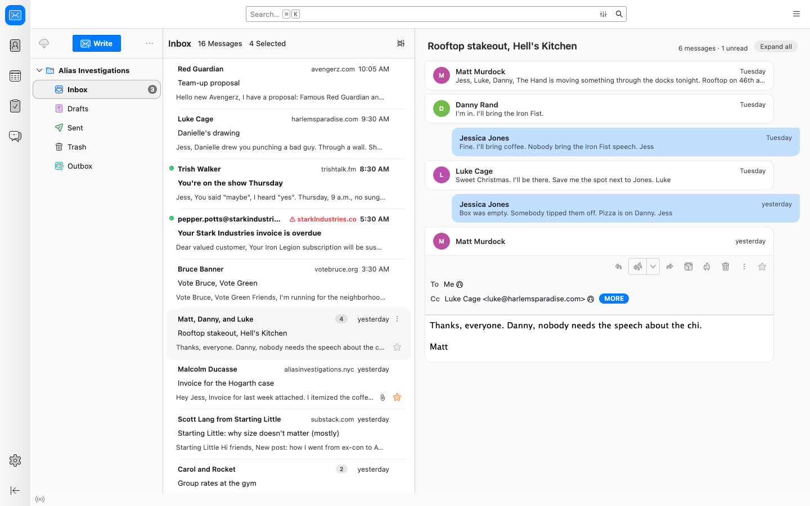
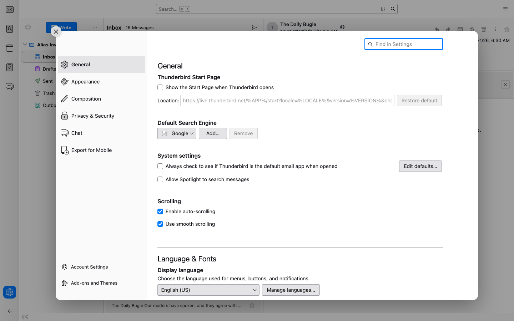
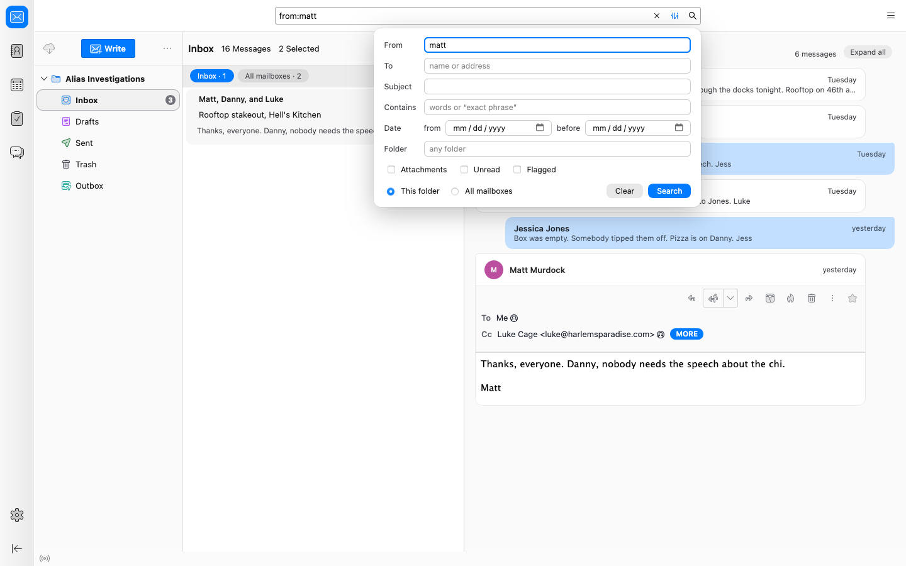
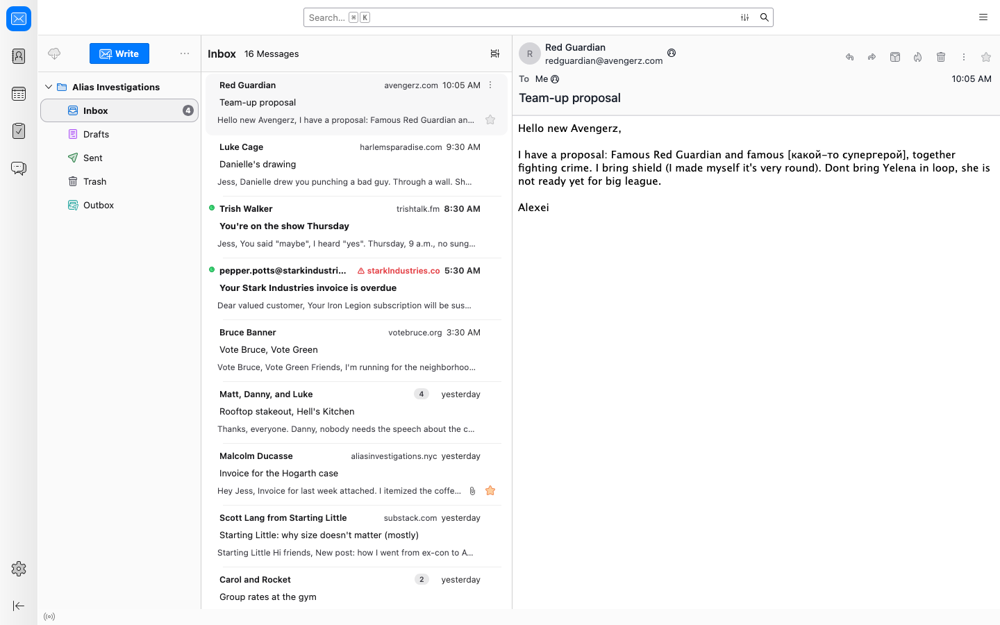
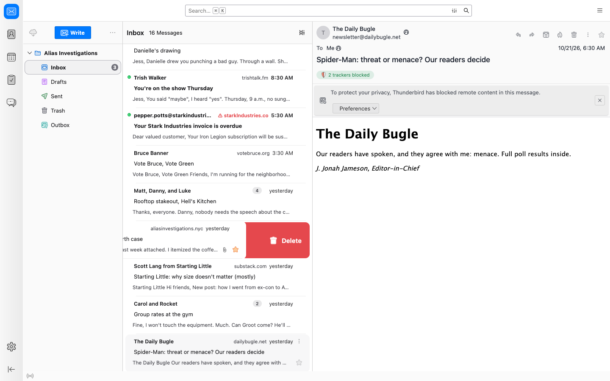
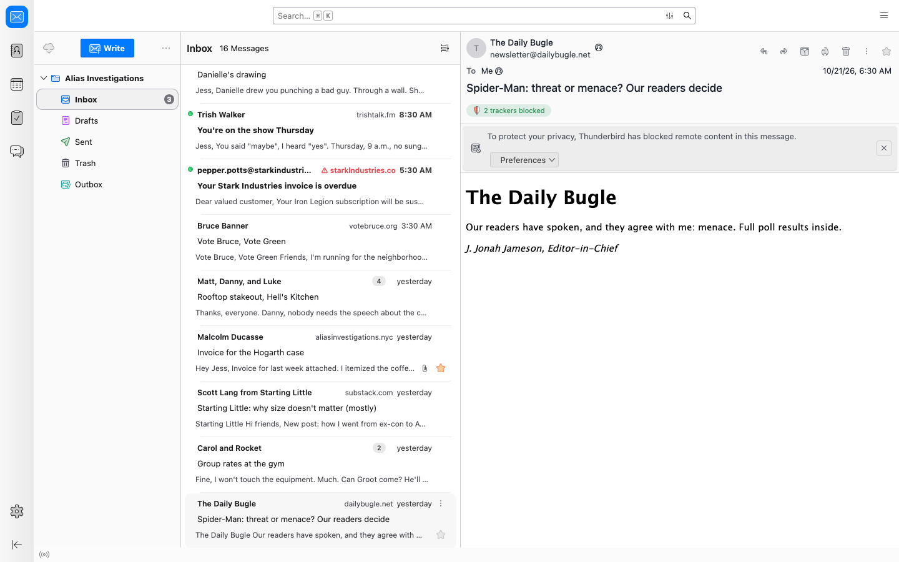
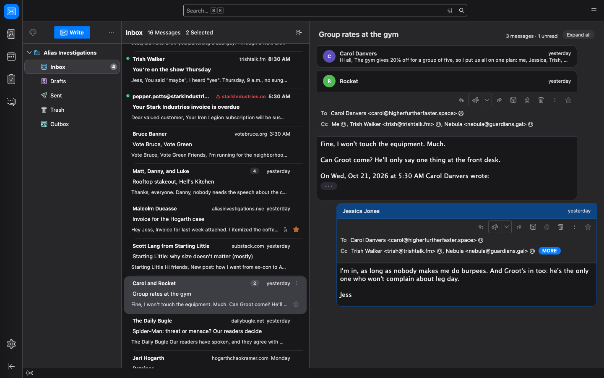

# heron, a zen Thunderbird *experiment*

Thunderbird is a fantastic mail client. But I'm a bit critical of its UX/UI. I spent some time thinking of where everything could be improved.

- conversation view and quoted mails
- tabs duplicating the workflow
- search spread into search and quick filters
- rough interface

## Important notes on security

heron needs access to Thunderbird core functions, like reading your emails: it's not meant to send anything to external servers, nor to load anything Thunderbird won't load, but if my GitHub account gets hacked, and the extension updates automatically to a corrupted version, you might be exposed - of course, I'm not responsible for data leaks or anything. Read [SECURITY.md](SECURITY.md) for more info. There is a userChrome.css file you can use without total access to Thunderbird's API (section *CSS-only edition* below), but you won't have the goodies. And hey, it's an *experiment*, a privileged code running inside Thunderbird, and Thunderbird asks for full access when you install it.

Full access is needed since Thunderbird's extension APIs can't reach the message list, the reading pane, the search field or the tab bar. heron therefore uses an *Experiment*,  All of the code is in this repository in readable form, with no minified or generated files. If a Thunderbird update breaks a module, heron turns that module off for that version and says so in its preferences, while Thunderbird keeps working normally.

**Full access is a lot to ask**, so you don't have to take my word for it. [SECURITY.md](SECURITY.md) lists what heron reads and writes, and explains how to check a release yourself: every package is built by GitHub Actions from the tagged source with a signed provenance attestation (`gh attestation verify`), and builds are reproducible, so you can rebuild one and compare its SHA-256.

## Privacy

heron collects nothing and sends nothing. It makes no network requests and contacts no server, including any server run by its developer. Everything it reads stays inside Thunderbird on your computer. I have no interest in seeing anything you do on your machine, at all.

## Conversation

The conversation view shows the flow of replies like instant messaging, with expandable and collapsible bubbles. Your own messages are on the right, in blue. Quoted parts are collapsed by default.



## Tabs

Agenda, contacts and messages are accessible with the left bar. Other tabs rather open in inset windows.



## Search

There is a single search field for the current folder or all folders, without opening a results tab. It understands keywords such as `from:`, `to:`, `subject:`, `before:`, `after:`, `in:` and `tag:` (Thunderbird's tags, such as Important), and `is:unread`, `is:flagged` and `has:attachment`, has an advanced filter panel, and offers suggestions as you type. The (i) button next to it lists these shortcuts; click one to add it to the field. The same field filters the calendar, tasks and contacts.



## Interface

The interface is more minimalist and smooth, with more breathing room and rounded cards. I added a short preview of the text under the subject, for messages already stored on your computer. The sender's real domain is shown next to their name, in red when the name imitates a known brand or hides a different address.



## Other goodies

- Swipe a message left to delete it, right to archive it (both configurable). The card holds still while your fingers rest on the trackpad.
- Long recipient lists can be expanded and collapsed.
- Tracking pixels are reported in the message header.
- Everything can be configured, and every feature can be turned off on its own.
- Undo send: a sent message waits a few seconds before leaving, 10 by default.
- The compose window is zen: Send stands out, Attach sits next to it and the formatting toolbar stays hidden until you ask for it.
- Light and dark modes.







The screenshots use a fictional inbox (`dev/demo-mail.py`). Any resemblance to Hell's Kitchen private investigators is entirely intentional.

## Languages

heron is available in English, Français and Español, for now. To add yours, copy the `EN` table in `dev/make-locales.py`, translate its values, add it to `LANGUAGES` and run the script.

## Install

heron requires Thunderbird 140 or later. For now, it is developed and tested on Thunderbird 158 on macOS. Windows and Linux should work but have seen less testing, so reports are welcome.

1. Download `heron-<version>.xpi` from the [latest release](https://github.com/essicolo/heron/releases/latest).
2. In Thunderbird, open Add-ons and Themes, click the gear icon, choose Install Add-on From File and select the downloaded file.
3. To change heron's settings, open Add-ons and Themes, select heron and open its Preferences tab.

Once installed, heron updates itself from this repository, and Thunderbird checks each update against the SHA-256 published in `updates.json`. If you would rather review each version first, turn automatic updates off for heron (Add-ons and Themes, heron, Allow automatic updates: Off) and update by hand.

## CSS-only edition

If you would rather not give any add-on full access, heron's look is also available as a plain style sheet. You get the calmer interface (cards, hairlines, the spaces bar, softer warnings, the compose toolbar), but nothing that needs code (no conversation view, swipe, unified search, sender domains or undo send).

1. Download `userChrome.css` from the [latest release](https://github.com/essicolo/heron/releases/latest), or take [css/userChrome.css](css/userChrome.css) from this repository.
2. In Thunderbird, open Help, Troubleshooting Information, and click Open Folder next to Profile Folder.
3. In that folder, create a folder named `chrome` if there isn't one, and put `userChrome.css` in it.
4. In Settings, General, Config Editor, set `toolkit.legacyUserProfileCustomizations.stylesheets` to `true`, then restart Thunderbird.

For the roomier density and a larger text size, use Settings, Appearance. To go back, delete the file and restart. The style sheet is generated from the add-on's own styles at each release, so both editions always look the same.

## Removing heron

Disabling or removing heron takes effect right away, without restarting Thunderbird.

heron won't break your setup. Once uninstalled, every change to the interface disappears and every Thunderbird setting that heron changed is restored. If a message is waiting to be sent because of undo send, it is sent immediately rather than left behind.

The preferences include a section called "If I remove heron". There you can choose to keep the roomier interface, the text size or the unified folders, which then become your own settings. Senders' full addresses are always restored, because without heron's domain hint the name alone could hide an impersonation.

## Following is vibe-coded

### Development

The repository is organised as follows.

- `extension/` contains the add-on itself.
  - `api/` is the privileged engine. It loads the modules, style sheets and settings, and undoes everything when heron or a module stops.
  - `content/` has one script per module.
  - `styles/` holds the style sheets.
  - `options/` is the preferences page.
  - `_locales/` holds the English, French and Spanish strings, generated by `dev/make-locales.py`.
- `dev/` contains the test bench and tools.
- `css/userChrome.css` is the CSS-only edition, generated by `dev/make-css.py` from the add-on's style sheets.
- `.github/workflows/release.yml` builds, checks, attests and publishes each release.

The modules in `extension/content/` are:

- `conversation.js`, the conversation view.
- `list.js`, for dates, sender domains, impersonation warnings and previews.
- `threads.js`, for one row per conversation.
- `swipe.js`, for swipe actions with undo.
- `search.js`, for unified and advanced search, including the calendar, tasks and contacts.
- `glance.js`, which replaces tabs with floating cards.
- `fold-quotes.js`, which folds quoted text and signatures.
- `recipients.js`, which makes recipient lists collapsible.
- `compose.js`, for the calmer compose window.
- `undo-send.js` and `undo-send-compose.js`, for undo send.
- `trackers.js`, for the tracker report in the message header.
- `theme-pane.js`, for appearance details such as the New message button and aligned pane headers.
- `window.js`, for unified folders.
- `revert.js`, which is always active and undoes lasting changes made by modules that were turned off.
- `prelude.js`, a set of helpers loaded before each module so that whatever the module installs is undone when it stops.

Each module can be turned off on its own, and none depends on another.

### Tests

The tests run in a headless Thunderbird with a throwaway profile and fictional messages. Your real profile is never touched.

```sh
dev/run-all.sh # every test suite, each on a fresh instance
dev/test-matrix.sh [module...] # each module alone, then each module removed
dev/preview.sh start # headless Thunderbird with the test profile
python3 -I dev/shoot.py screenshot /tmp/heron.png 1440 900
dev/preview.sh stop
```

`dev/screenshots.sh` rebuilds the images in `docs/screenshots/` from the demo inbox. It needs an English build of Thunderbird (a localized one keeps folder names in its own language), passed as its argument.

`dev/fixtures/quotes/` holds reply formats taken from real clients (Outlook in English, French and Spanish, Gmail, Apple Mail, Thunderbird and plain text) and is used to test quote folding. If heron folds a message badly, that message makes a good new fixture once it has been anonymized.

### Release

```sh
python3 -I dev/make-locales.py # after changing strings
dev/release.sh essicolo/heron # builds the package and adds it to updates.json
git add -A && git commit -m "heron <version>" && git push
git tag v<version> && git push origin v<version>
```

`dev/release.sh` builds `dist/heron-<version>.xpi` with `dev/pack.py`, which is reproducible, and records its SHA-256 in `updates.json`. Pushing the tag starts the release workflow: it rebuilds the package from the tagged source, checks that it matches `updates.json` exactly, attests it and publishes the release, with the version's section of `CHANGELOG.md` as release notes.

## License

heron is released under the GPL-3.0 license. See `LICENSE`.
